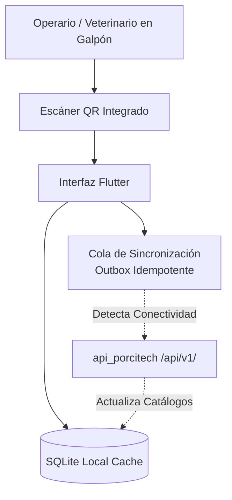

# PorciTech Mobile — Operación de Campo Offline-First & Trazabilidad QR

Aplicación móvil multiplataforma desarrollada en **Flutter** y **Dart** para el ecosistema **PorciTech**. Diseñada específicamente para galpones rurales con conectividad intermitente o nula, permitiendo registrar pesajes, eventos sanitarios y lecturas de códigos QR sin bloquear la operación en campo.

- **Caso de estudio técnico:** [santiagoavirama.dev/proyectos/porcitech](https://santiagoavirama.dev/proyectos/porcitech)
- **Integración Backend:** [`DevAvirama/api_porcitech`](https://github.com/DevAvirama/api_porcitech)

---

## Arquitectura Offline-First



### Características de Ingeniería

- **Persistencia Local Resiliente:** Caché estructurada de animales, corrales/lotes y protocolos sanitarios para consulta instantánea sin acceso a Internet.
- **Cola de Sincronización (_Outbox Pattern_):** Las transacciones creadas fuera de línea se encolan localmente con identificadores únicos y se despachan automáticamente hacia `/api/v1/` al restablecer la red.
- **Identificación Rápida por QR:** Lectura óptica de etiquetas QR en campo para abrir el historial clínico y registrar novedades en segundos.

---

## Requisitos y Ejecución

### Prerrequisitos

- Flutter SDK (`>= 3.x`) y Dart SDK
- Dispositivo Android/iOS o emulador configurado

### Instalación

```bash
git clone [https://github.com/DevAvirama/porcitech_mobile.git](https://github.com/DevAvirama/porcitech_mobile.git)
cd porcitech_mobile
flutter pub get
flutter run --dart-define=API_BASE_URL=[http://10.0.2.2:8000/api/v1](http://10.0.2.2:8000/api/v1)
```

### Compilación Release (Android APK)

```bash
flutter build apk --release --dart-define=API_BASE_URL=[https://api.tu-dominio.com/api/v1](https://api.tu-dominio.com/api/v1)
```
